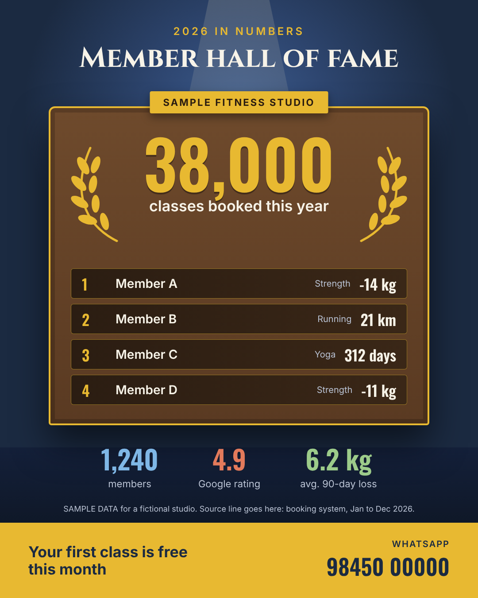

<div align="center">

# Marketing Design Skills

### Turn your AI assistant into a marketing and design team.

**Three open-source skills for Claude, ChatGPT, Grok, Gemini and Codex: data infographics and ad creatives, Instagram and Meta ads growth and an ad creative director that remembers every client.**

Built and maintained by [**Clicrore Tech**](https://clicrore.com), a digital marketing and web development studio.

[](LICENSE)


[](https://clicrore.com)

</div>

<br>

<p align="center"></p>

## Why this exists

Ask a chatbot for a social post or an ad and you get the same thing everyone else gets: "In today's fast-paced world", "unlock your potential", a stock photo, a card grid, an em dash in every sentence. People scroll straight past.

These skills write down what a working performance marketing studio actually does, as steps an AI can follow:

- **Every piece has a commercial job.** One audience, one action, one ask.
- **Proof beats claims.** Numbers carry their source, superlatives need evidence, testimonials need consent.
- **Every draft is humanized.** A script strips AI tells and tired marketing cliches before you see the text.
- **Every design is checked at phone size.** If it does not read on a 6-inch screen, it is not done.
- **Real tools, not just prompts.** Seven scripts actually run: renderers, linters, scorers and a client memory.

## The three skills

| Skill | What it does | Tools that run |
| --- | --- | --- |
| [**infographic-studio**](skills/infographic-studio) | Turns results, reviews, prices, processes and facts into scroll-stopping infographics and ad creatives. Six design languages, six canvas presets from feed ads to print. Renders PNG, MP4 and GIF. | `check.mjs` catches overlapping text, clipping, Story safe-zone problems, low contrast and unsourced claims. `render.mjs` renders still and video. |
| [**social-growth-engine**](skills/social-growth-engine) | Ten modes for running Instagram and Meta ads: Reels, carousels, captions, Stories, comment replies, lead follow-ups, weekly plans, Meta lead ad copy, audits and profile scoring. | `hookscore.py` ranks Reel hooks. `humanize.py` removes AI tells. `caption_check.py` shows what the feed shows before "more". |
| [**ad-creative-director**](skills/ad-creative-director) | Art directs original ad creatives, posters, thumbnails and Reel covers: brief, three real concepts, a handoff spec, image prompts, exact typography and a ten-point quality gate. | `client_memory.py` stores each client's brand, decisions and feedback. `gate.py` checks size and makes a phone preview. |

All three share one **brand profile** (`~/.marketing-skills/brands/<name>.md`), so you describe a client once and every skill knows their offer, proof, colours and contact.

## Install

### Claude Code (Mac, Linux, Windows with WSL)

```bash
git clone https://github.com/Clicrore-Tech/marketing-design-skills.git
cd marketing-design-skills
./install.sh
```

The installer copies the skills into `~/.claude/skills` and into any other agent folder it finds (Codex, Gemini CLI, Hermes), creates the `~/.marketing-skills` memory folder and sets up the renderer.

Or as a plugin inside Claude Code:

```
/plugin marketplace add Clicrore-Tech/marketing-design-skills
/plugin install marketing-design-skills
```

### Claude app, ChatGPT, Grok and Gemini

Step-by-step setup as a Claude uploaded skill, a Custom GPT, a Grok project or a Gemini Gem: [docs/use-with-other-ai.md](docs/use-with-other-ai.md).

### Requirements

- Python 3.9+ for the writing and memory tools (standard library only)
- Node.js 18+ for rendering infographics (`install.sh` sets up Playwright and Chromium)
- `ffmpeg` only for MP4 or GIF output

Nothing is uploaded anywhere. The scripts run on your machine, on your files.

## Try it

```
/social-growth-engine plan my week for a bakery in Pune, we launch a new sourdough on Friday

/infographic-studio make a feed post: 1,240 members, 4.9 Google rating, 38,000 classes this year

/ad-creative-director Meta lead ad for a dental clinic, first consultation free, ends 30 June
```

## Built by Clicrore Tech

[**Clicrore Tech**](https://clicrore.com) is a digital marketing and web development studio. We run:

- **Meta ads** (Facebook and Instagram) built around leads that sales teams can actually close
- **Instagram content** that people save and forward
- **WordPress and Elementor websites** that turn ad clicks into enquiries
- **AI automation** for content, creatives and lead follow-up

These skills are a slice of the playbook we use with clients. Want the full version run for your brand? **Visit [clicrore.com](https://clicrore.com).**

## Contributing

Pull requests are welcome, especially new design languages, hook formulas that worked for you (with numbers) and translations of the humanizer word list.

## License

[MIT](LICENSE) © [Clicrore Tech](https://clicrore.com)
